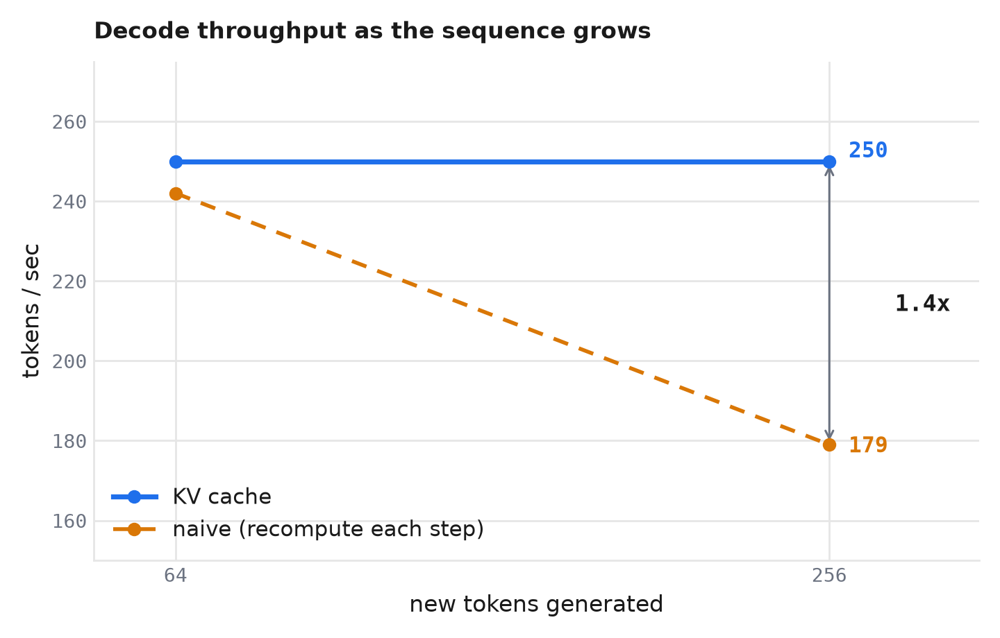

# Building a KV cache, and the honest speedup

Last post I built a GPT from scratch and it learned to write stories. It also had a problem: generating text was embarrassingly wasteful. This post is the fix, the KV cache, the first real piece of inference engineering. I built it, proved it correct, and measured exactly how much faster it made things. The answer was 1.4x, and the why is the interesting part.

## The waste

To generate text, the model produces one token at a time. Here's the wasteful bit. Say it's writing "the cat sat on the mat":

- to generate "sat", it processes "the cat" through the whole model,
- to generate "on", it processes "the cat sat", reprocessing "the cat" again,
- to generate "the", it processes "the cat sat on", reprocessing "the cat sat" again.

Every new token, it reprocesses the entire sequence before it, from scratch. For a 500-token story, the first token gets reprocessed about 500 times. It's O(T^2) work to produce T tokens, and most of it is redundant.

## Why it's safe to stop

The key is causal attention: every token only looks left, at itself and the tokens before it. So when "the cat" got processed at step one, what it computed depended only on "the cat." Adding "sat" or "on" later changes nothing about what "the" or "cat" computed. Their work is done and frozen. Recomputing it every step just reproduces the same numbers.

So you compute each token's reusable part once, save it, and reuse it. That saved thing is the KV cache.

## What gets cached, and what doesn't

In attention, each token makes three things: a query (what I'm looking for), a key (what I advertise), and a value (what I hand over). When a new token generates, it needs its own query, plus the keys and values of all the previous tokens to score against and blend in.

Those previous keys and values don't change, so you cache them. Hence the name: Keys and Values.

The nice subtlety is that you cache keys and values but not queries. A past token's query was used exactly once, at its own moment, to generate itself, and never again. Nothing in the future ever looks at token 50's query. But token 50's key and value are needed by every future token that looks back at it. You save what gets reused and skip what doesn't.

## Two phases: prefill and decode

With the cache, generation splits cleanly in two:

- **Prefill:** run the whole prompt through once, filling the cache with every prompt token's keys and values.
- **Decode:** generate one token at a time. Each step computes just the new token's query, key, and value, appends its key and value to the cache, attends against the whole cache, and predicts the next token.

The expensive "process everything" happens once, in prefill. After that, every token is cheap.

## Proving it before trusting it

Here's the part I care about most. A cache is exactly the kind of optimization that can be subtly wrong, produce slightly different output, and you'd never notice, because the text still looks plausible.

So before measuring any speed, I wrote a correctness test: generate greedily through the cached path and through the naive recompute-everything path, and assert the two outputs are byte-identical. If they ever diverge, the cache is broken. It passed. The fast path provably produces the exact same tokens as the slow path.

That's my rule for the whole project: no optimization counts until something other than me confirms it's still correct.

## The speedup, measured honestly

Then I timed it, generating from a short prompt on my 6GB laptop GPU:

<!-- IMAGE: line chart, tokens/sec vs new tokens generated (64 and 256). naive line degrades 242 -> 179, cache line stays flat ~250. Produce in goals via chart_style.py: cache in identity blue #1f6feb, naive in amber #d97706, label the endpoints. -->

The shape is the point. The cache holds a steady ~250 tokens/sec no matter the length. Naive starts close but degrades as the sequence grows, because it does more work every token. By 256 tokens the cache is 1.4x faster, and the gap widens the longer you generate.

Now the honest part. The number is **1.4x, well short of the 10x you might have expected**, and that's the correct answer at this scale. At 51M parameters and a few hundred tokens, each generated token is dominated by fixed costs (the output projection over 50,000 vocabulary words, kernel-launch overhead) rather than the attention recompute the cache removes. The cache eliminates the O(T^2) attention work, but at this size that work is a small slice of the total. Its payoff scales with sequence length, so on long contexts it's dramatic, and on short stories it's modest.

I could have reported a bigger number by cherry-picking a longer sequence or a larger model. The real result is more useful: for a single stream at this scale, the bottleneck is overhead, not recompute.

## Which is exactly why batching is next

That finding is the whole argument for the next piece. If each token is dominated by fixed overhead, the way to win is to amortize that overhead across many requests at once: run a batch of them through the same forward pass. The KV cache is what makes that possible, since each request carries its own cache. Batching is where the fixed overhead stops mattering and throughput takes off.

So next: wrap this in a server, run many requests at once, and go find the throughput the roofline promised back in part one.
